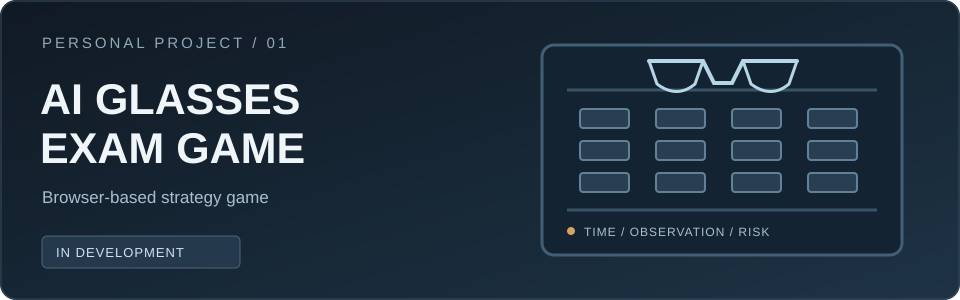

# DONGHYUK

**AI Applications & Personal Projects**

마케팅 실무 경험을 바탕으로 AI 서비스 기획과 개발을 학습하고 있습니다. 현재 NVIDIA AI 교육과정에 참여하며 개인 프로젝트와 실습을 기록하고 있습니다.

[전체 포트폴리오](https://github.com/dong9610-10/dong961010) · [교육 기록](https://github.com/dong9610-10/dong961010/blob/main/learning/nvidia-ai-training/README.md) · [Python 및 AI 실습](https://github.com/dong9610-10/dong961010/blob/main/learning/python-ai-learning-lab/README.md)

---

## 01 / Featured Project

### AI 안경 수능 게임

제한 시간과 문제 풀이, 감독관의 감시 및 적발 위험을 결합한 브라우저 기반 게임입니다.

개인 프로젝트 · 개발 및 개선 중

- 게임 규칙과 사용자 흐름 기획
- ChatGPT 및 Codex를 활용한 구현과 기능 개선
- 플레이 경험, 결과 화면 및 반복 플레이 요소 개선

**[게임 실행](https://ai-glasses-exam-room.sage-crab-8888.chatgpt.site/) · [프로젝트 상세 보기](https://github.com/dong9610-10/dong961010/blob/main/projects/ai-glasses-exam-game/README.md)**

상단 이미지는 프로젝트 소개용 그래픽이며 실제 플레이 화면은 아닙니다.

---

## 02 / AI Experiments

AI API와 Python을 활용한 학습 및 구현 실습입니다.

| 실습 | 활용 기술 | 진행 상태 |
|:---|:---|:---|
| [속담 그림 퀴즈](https://github.com/dong9610-10/dong961010/blob/main/learning/nvidia-ai-training/2026/11/2026-11-23.md#7-속담-그림-퀴즈-25쪽) | Image Generation, Gradio | 실행 확인 · 개선 중 |
| [그림판 Artist](https://github.com/dong9610-10/dong961010/blob/main/learning/nvidia-ai-training/2026/11/2026-11-23.md#63-그림판-artist-26쪽) | Vision, Image Generation | 구현 예제 |
| [통역기 APP](https://github.com/dong9610-10/dong961010/blob/main/learning/nvidia-ai-training/2026/11/2026-11-23.md#82-통역기-app-46쪽) | STT, LLM, TTS | 구조 및 실습 정리 |
| [영어 회화 퀴즈](https://github.com/dong9610-10/dong961010/blob/main/learning/nvidia-ai-training/2026/11/2026-11-23.md#83-영어-회화-퀴즈-47쪽) | STT, LLM, TTS | 구현 예제 |
| [계산기 및 BMI 계산기](https://github.com/dong9610-10/dong961010/blob/main/learning/python-ai-learning-lab/README.md) | Python, Gradio | 실행 확인 |

| [Tool Calling 및 MCP](https://github.com/dong9610-10/dong961010/blob/main/learning/nvidia-ai-training/2026/11/2026-11-24.md) | Function Calling, Requests, FastMCP | 학습 및 실습 구조 정리 |

[전체 실습 목록 보기](https://github.com/dong9610-10/dong961010/blob/main/learning/python-ai-learning-lab/README.md)

---

## 03 / Technical Focus

| 분야 | 학습 및 활용 기술 |
|:---|:---|
| Programming | Python |
| AI Applications | OpenAI API, LLM, Prompt Engineering |
| Multimodal | Vision, Image Generation, STT, TTS |
| Application UI | Gradio |
| Tool Integration | Function Calling, Requests, JSON Schema, FastMCP, Remote MCP (학습 중) |
| Development Environment | VS Code, Google Colab, GitHub, Codex |

---

## 04 / Learning Journey

**NVIDIA AI Education Program** · 교육과정 참여 중

강의 내용, 실습 과정, 오류 해결 및 개선 내용을 날짜별로 기록합니다.

**최근 학습:** [2026-11-24 — Tool Calling, Requests & MCP](https://github.com/dong9610-10/dong961010/blob/main/learning/nvidia-ai-training/2026/11/2026-11-24.md)

**팀 프로젝트:** 온라인 콘텐츠·크리에이터 분야 — 문제 정의 및 서비스 방향 검토 중. [기획 기록](https://github.com/dong9610-10/dong961010/blob/main/learning/nvidia-ai-training/2026/11/2026-11-24.md#8-팀-프로젝트-분야-선정)

- [날짜별 교육 기록](https://github.com/dong9610-10/dong961010/blob/main/learning/nvidia-ai-training/README.md)
- [멀티모달 AI](https://github.com/dong9610-10/dong961010/blob/main/learning/nvidia-ai-training/topics/multimodal-vision.md) · [이미지 생성](https://github.com/dong9610-10/dong961010/blob/main/learning/nvidia-ai-training/topics/image-generation.md) · [음성 처리](https://github.com/dong9610-10/dong961010/blob/main/learning/nvidia-ai-training/topics/speech-audio.md)

---

[Portfolio Repository](https://github.com/dong9610-10/dong961010)

프로젝트 기획과 AI 도구를 활용한 구현·학습 과정을 기록합니다. 실행 확인 여부와 개발 진행 상태는 각 문서에 구분하여 표시합니다.
